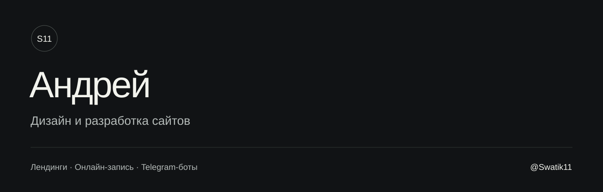
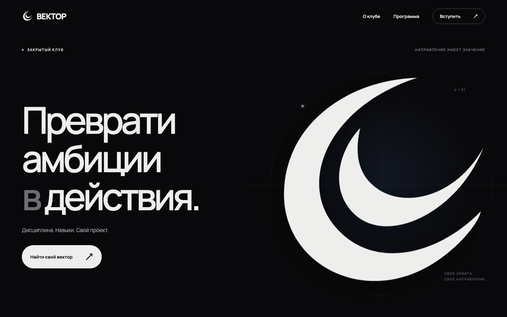

Создаю веб-интерфейсы и инструменты автоматизации: лендинги, онлайн-запись, Telegram-боты и панели управления.

**[Обсудить проект в Telegram](https://t.me/Swatik11)** · [Личный профиль](https://github.com/laladr1108-creator) · [Сервисы и боты](#сервисы-и-боты)

## VECTOR — лендинг закрытого клуба

Лендинг с крупной типографикой, анимацией знака и последовательным раскрытием карточек программы. Фотографии, шрифт и скрипты включены в статическую сборку; мобильная версия и режим уменьшенного движения предусмотрены отдельно.

**Что сделано:** дизайн и вёрстка, сцены GSAP/ScrollTrigger, адаптация под телефон, доступность контента без JavaScript.

**Стек:** HTML · CSS · JavaScript · GSAP

**[Открыть сайт](https://vector-club-orbit.flowylyric64.chatgpt.site)** · [Подробнее о проекте](cases/vector.md)

## FORMA — сайт детейлинга и онлайн-запись

Фотографическая витрина с услугами, галереей и записью. Клиент выбирает услугу и время; студия получает заявку и работает с ней в кабинете. Шаблон настраивается под разные компании через рабочее пространство студии.

**Что сделано:** адаптивный сайт, услуги и цены, расчёт свободного времени, кабинет заявок, согласование и публикация, Telegram-уведомления.

**Стек:** Next.js · React · TypeScript · SQLite

**[Открыть демонстрацию](https://demo.vexora.press/p/test)** · [Подробнее о проекте](cases/forma.md)

> Демонстрация шаблона, не коммерческий заказ Galleria Car Spa. Использованы реальные фотографии Tima Miroshnichenko из этой студии и Zac Nielson. [Авторы, источники и условия использования](ASSET_SOURCES.md).

## Сервисы и боты

### Nutrition Bot — дневник питания в Telegram

Профиль пользователя, расчёт калорий и БЖУ, дневник питания, поиск продуктов и добавление по штрих-коду. Отдельное мини-приложение показывает суточную статистику и прогресс.

**Стек:** Python · aiogram · SQLite · Telegram Web App

**[Исходный код бота](https://github.com/adpetrovskiy-dot/nutrition-bot-)** · [Интерфейс статистики](https://github.com/adpetrovskiy-dot/nutrition-bot-webapp) · [Описание проекта](cases/nutrition-bot.md)

### VEXORA IP Roller

Веб-панель для управления подбором облачных IPv4: несколько аккаунтов, правила IP/CIDR, лимиты, фоновые задания, история попыток, события в реальном времени, Telegram и внешний probe.

**Стек:** React · FastAPI · PostgreSQL · Celery · Redis · Docker

[Описание и возможности](cases/ip-roller.md). Скриншот сделан в демосреде с тестовым провайдером; реальные облачные аккаунты не проверены.

### VEXORA Proxy

Telegram-сервис прокси-подписок: пробный и платный доступ, баланс, покупка, продление и административные команды. Интеграции платежей, восстановление незавершённых операций и хранение состояния на постоянном томе.

**Стек:** Python · Telegram Bot API · SQLite · Railway

[Описание проекта](cases/proxy.md)

### VPN-инфраструктура

Сопровождение и диагностика сервиса на Remnawave/Xray: конфигурация, маршрутизация, доступность узлов, подписки и восстановление. Этот кейс показывает эксплуатационную работу с существующей инфраструктурой.

**Технологии:** Linux · Remnawave · Xray · Python

[Объём работ](cases/vpn.md)

### VECTOR Content Bot

Отдельный Telegram-бот для поиска референсов и подготовки контент-подборок: Pinterest, избранное, история без повторов, исходные ссылки и доставка медиа. Доступ ограничен разрешёнными пользователями.

**Стек:** Python · Telegram Bot API · SQLite · ffmpeg · Docker

[Описание проекта](cases/content-bot.md). Автопубликация в TikTok и Threads не подключена.

### ШинСлот

Прототип онлайн-записи на шиномонтаж: расчёт цены по параметрам авто, запись в четыре шага, свободное время с учётом длительности и числа постов. В панели владельца — календарь, заявки, прайс и расписание.

**Стек:** React · Vinext · Cloudflare Workers · D1

**[Исходный код](https://github.com/slavuus-and-swatik/shinslot-booking)** · [Описание проекта](cases/shinslot.md)

## Интерфейсы и прототипы

Интерактивные примеры на HTML, CSS и JavaScript. Расчёты и переключения показаны в браузере; серверные интеграции в эти демонстрации не входят.

| Проект | Сценарий |
|---|---|
| [КБЖУ Coach](https://laladr1108-creator.github.io/Nemoswatik/projects/01-kbju-coach/index.html) | Расчёт нормы, добавление еды и отображение дневного прогресса. |
| [FluxVPN](https://laladr1108-creator.github.io/Nemoswatik/projects/02-fluxvpn/index.html) | Кабинет с выбором сервера, тарифом, устройствами и состояниями подключения. |
| [Exclusive Partners](https://laladr1108-creator.github.io/Nemoswatik/projects/03-exclusive-partners/index.html) | Партнёрская CRM: фильтры, статусы и расчёт комиссии. |
| [Order Bot UI](https://laladr1108-creator.github.io/Nemoswatik/projects/04-telegram-order-bot/index.html) | Интерфейс заказа: меню, корзина и статусы. |
| [Support Bot UI](https://laladr1108-creator.github.io/Nemoswatik/projects/05-telegram-support-bot/index.html) | Интерфейс обработки обращений: приоритеты и шаблоны ответов. |

## Связаться

[**Telegram: @Swatik11**](https://t.me/Swatik11)

Расскажите о задаче: какой сайт, бот или инструмент нужен и как он должен работать.
